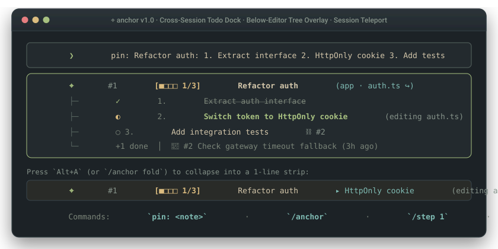

# ⌖ Anchor

> **A digital sticky note docked below your Pi editor — 0ms instant stick, micro progress bars `[■■□□ 2/4]`, 1-click session teleport (`↪`), and automatic teardown on `git commit`.**

[](https://github.com/3ZEROS12/anchor/actions/workflows/ci.yml)
[](package.json)
[](tsconfig.json)
[](tests/store.test.ts)
[](package.json)
[](LICENSE)

**English** | [简体中文](./README_zh.md)

```bash
pi install npm:pi-anchor
```

<p align="center">
  
</p>

```text
  ┌─ [aboveEditor stays 100% free for pi-lingual and other HUD widgets] ────────────┐
╭─┴─ Pi Editor ────────────────────────────────────────────────────────────────────╮
│ ❯ pin: Refactor auth flow: 1. Extract interface 2. HttpOnly cookie 3. Unit tests │
╰─┬────────────────────────────────────────────────────────────────────────────────╯
  └─► ⌖ #1 [■■□□ 2/4] Refactor auth flow ▸ Unit tests (app · auth.ts ↪)
```

---

## Core Value

Late at night, mid-way through fixing a bug, you spot a second issue in `src/auth.ts` or need to pause a multi-step refactor until tomorrow. Standard ways of recording that note create immediate friction:

1. **Terminal Exit Wipes Working Memory**: Closing the terminal or running `/new` clears the agent's context. Yesterday's unfinished steps and the conversation history behind them vanish.
2. **`TODO.md` Pollutes Git & Burns Context Tokens**: Tracking personal reminders inside repository markdown files dirties `git status` and re-injects stale checklists into the system prompt on every turn.
3. **Splash Banners Vanish When You Start Typing**: Traditional startup widgets disappear on the first message. For the rest of a two-hour session, your notes are hidden unless you manually run a slash command.

**Anchor acts like a physical sticky note stuck to the bottom bezel of your Pi editor**:
- **Persistent Below-Editor Strip (`belowEditor`)**: Docks a single-line note strip directly beneath your input box. It stays in view while you code, leaves `aboveEditor` untouched for extensions like `pi-lingual`, and collapses to 0 lines when empty.
- **0ms Human-First Capture (`pin: ...`)**: Type `pin: Check token expiry` (or `/pin ...`) straight into the editor. An input hook intercepts the text in `0.00ms` without calling the language model or spending tokens.
- **Micro Progress Bar (`[■■□□ 2/4]`)**: Write `[2/4]` or numbered steps (`1. Extract interface 2. HttpOnly cookie 3. Unit tests`) in your note to get an inline 4-cell progress bar with next-step hints.
- **Session Teleport (`↪ Jump to session`)**: Every note bookmarks the exact `.jsonl` session file where it was created or last touched. Select `↪ Jump to session` in `/anchor` to switch Pi straight back to that conversation.

---

## How It Works

| Mode / Action | What You Input | What the Engine Does | What You See | Best For |
| :--- | :--- | :--- | :--- | :--- |
| **Stick a Note (0ms)** | Type `pin: Fix auth in src/auth.ts` or `/pin ...` | Intercepts via input hook in `0ms`, extracts file paths, and links current `sessionFile` | 1-line strip appears below editor: `⌖ #1 Fix auth (app · auth.ts ↪)` | Capturing a tangent without derailing the current prompt |
| **Track Multi-Step Work** | Type `/pin Refactor: 1. API 2. Cookie 3. Tests` then `/step 1` | Parses step list and increments `done / total` counter in `~/.anchor/state.json` | Strip updates in place: `⌖ #1 [■■□□ 2/3] Refactor ▸ Tests` | Multi-session features and long-running study goals |
| **Resume Context (`↪`)** | Run `/anchor` ➔ select `↪ Jump to session` (or `/anchor jump 1`) | Invokes Pi's native `ctx.switchSession(note.sessionFile)` | Terminal switches directly back to the original conversation transcript | Picking up a complex task days later with full history |
| **Auto-Tear on Commit** | Commit code (`git commit -m "feat: fix auth"`) or run `/done 1` | Matches commit message against active notes (filtering generic stop-words) | Note archives to `archive.jsonl`; strip clears (`⌖ Auto-torn off #1`) | Keeping the sticky strip clean without manual bookkeeping |

---

## Features & Engineering Answers

### 1. Will the sticky strip collide with `pi-lingual` or overflow narrow split panes?
Anchor mounts its widget with `{ placement: "belowEditor" }`. Extensions that render translation cards or diagnostics above the input box (`aboveEditor`) never overlap with Anchor.  
On narrow terminal splits (such as 50-column tmux panes), the strip measures visual column widths using Unicode East Asian Width rules (CJK/emoji = 2 cells, ASCII = 1 cell) and dynamically folds multiple notes into `⌖ 3: #1 [■■□□ 2/4] Refactor… +2` while stripping unclosed brackets before ellipses.

### 2. Does keeping sticky notes cost tokens on every turn?
**Turn 2+ consumes 0 system prompt tokens.**  
Anchor injects a compact summary of active notes only on Turn 1 of a cold session. From Turn 2 onwards, the system prompt hook returns nothing. When the agent reads or edits a file that matches a note's path or glob (`src/auth/*.ts`), Anchor appends a single syntax-safe comment line (`// ⌖ Note #1: ...`) to that tool result, while returning `null` for `.json`, `.env`, lockfiles, and binaries.

### 3. What happens to old notes or accidental `git commit` matches?
- **7-Day Quiet Mode (Zero Silent Deletion)**: Notes untouched for more than 7 days transition to `sleeping` (`quiet`). They stop appearing in Turn-1 prompts for unrelated workspaces, remain 100% visible in `/anchor`, and wake up automatically when you open their target project.
- **Stop-Word Filtered Commit Matching & 1-Tap Undo**: Commit matching strips generic words (`fix`, `feat`, `chore`, `bug`, `update`) so a commit like `fix: typo in bug template` never tears off a note titled `fix bug in login`. If you ever tear off a note by mistake, `/anchor undo` pops the last entry from `archive.jsonl` right back onto your strip.
- **Bracketed Ratio Parsing**: Progress ratios require explicit brackets (`[2/4]` or `(5/30)`), ensuring calendar dates in note titles (like `Before 10/12 release`) are never mistaken for progress bars.

### 4. Storage Topology & Cross-Process Lock Safety
All state lives in `~/.anchor/` outside your git repository:
```text
~/.anchor/
├── state.json      # Active and quiet sticky notes (< 2KB, atomic temp-file + rename)
├── state.lock      # Cross-process exclusive lock (fs.openSync 'wx' + dead-PID reclamation)
└── archive.jsonl   # Append-only history of torn-off notes (powers /anchor undo)
```

---

## Commands

| Where | Input / Command | Description |
| :--- | :--- | :--- |
| **Pi Editor** | `pin: <note>` or `便签: <note>` | Stick a note in **0ms** without calling the LLM |
| **Pi Slash** | `/pin <note>` | Stick a note (supports `[1/4]` or `1. A 2. B 3. C` steps) |
| **Pi Slash** | `/anchor` | Open interactive sticky note board (tear off, `+1` step, `↪` jump to session, or read details) |
| **Pi Slash** | `/step 1` | Advance progress bar on note `#1` by `+1` |
| **Pi Slash** | `/anchor jump 1` | Switch Pi back to the conversation session linked to note `#1` |
| **Pi Slash** | `/done 1` / `/anchor 1` | Tear off note `#1` and archive it |
| **Pi Slash** | `/anchor undo` | Put back the most recently torn-off note |
| **Terminal CLI** | `anchor` / `anchor "<note>"` | View or stick notes from any shell outside Pi |
| **Terminal CLI** | `anchor step 1` / `anchor done 1` / `anchor undo` | Advance progress, tear off, or restore notes from the command line |

---

## Author's Note

Anchor started because I hated watching `TODO.md` files rot inside my git repositories, yet closing my terminal at night always meant losing track of what I still needed to fix the next morning.

In its early versions, I over-engineered the solution. By `v0.3`, Anchor had grown into a 10-file miniature project manager with four cognitive quadrants (`Today`, `Upcoming`, `Habits`, `Backlog`), `[P0]` priority tags, daily recurring habit trackers, pre-flight shell test runners on startup, and a graveyard eviction state machine. Ironically, the more features it gained, the less I wanted to use it. Worse, its startup banner disappeared the moment I typed my first message, hiding my notes for the rest of the coding session.

In `v0.4` and `v0.5`, I threw away 60% of the codebase and rebuilt Anchor around four files (`types.ts`, `store.ts`, `tui.ts`, `extension.ts`) as a simple digital sticky note:
1. Dock the 1-line note strip **below** the editor (`belowEditor`) so it stays in sight while coding and never fights with `pi-lingual` above the editor.
2. Let human hands stick a note in `0ms` by typing `pin: ...` without waiting on a model call.
3. Add a 4-cell progress bar (`[■■□□ 2/4]`) for multi-step refactors and bookmark the session file (`↪`) so clicking a note teleports you back to the exact conversation where the work started.

```bash
npm run typecheck  # Strict tsc --noEmit check (0 errors)
npm test           # Native Node test runner (10/10 passing)
npm run build      # Dual ESM/CJS compilation via tsup + declaration emit
```

---

## License

MIT © [Jason Song](https://github.com/3ZEROS12)
