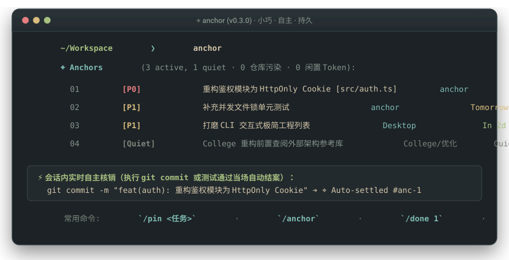

# ⌖ Anchor

> **贴在 Pi 输入框正下方的跨会话电子便签与 `todo` 自动存档点 —— 关终端自动接管未完 `todo` 进度 `[■■□□ 2/5]`，敲 `便签: ...` 0ms 瞬贴支线灵感，敲 `/back` 一键穿越回原对话，`git commit` 自动撕便签。**

[](https://www.npmjs.com/package/pi-anchor)
[](https://www.npmjs.com/package/pi-anchor)
[](https://github.com/3ZEROS12/anchor/stargazers)
[](https://github.com/3ZEROS12/anchor/actions/workflows/ci.yml)
[](tests/store.test.ts)
[](LICENSE)

[English](./README.md) | **简体中文**

```bash
pi install npm:pi-anchor
```

<p align="center">
  
</p>

```text
  ┌─ [输入框上方 aboveEditor 完全留给 pi-lingual 等插件，上下零冲突] ─────────────┐
╭─┴─ Pi 输入框 ────────────────────────────────────────────────────────────────────╮
│ ❯ 便签: 重构鉴权流: 1. 抽出接口 2. 替换HttpOnly Cookie 3. 补齐集成单测          │
╰─┬────────────────────────────────────────────────────────────────────────────────╯
  ├─► ⌖ #1 [■□□□ 1/3] 重构鉴权流 (app · auth.ts ↪)                    [Alt+A 折叠]
  │   ├─ ✓ 1. 抽出接口 (删除线，下一轮自动收起)
  │   ├─ ◐ 2. 替换HttpOnly Cookie (editing auth.ts)
  │   ├─ ○ 3. 补齐集成单测 ⛓ #2
  │   └─ 📌 #2 检查网关超时降级重试 (3h ago)
  └─► (按 Alt+A 一键折叠为 1 行): ⌖ #1 [■□□□ 1/3] 重构鉴权流 ▸ 替换Cookie (auth.ts ↪)
```

---

## Core Value

深夜写代码查问题时，你经常顺眼看到另一个文件里的隐患，或者手头的长线重构今天只做了一半。传统的记录方式总有三处具体的别扭：

1. **关掉终端或开新会话即失忆**：按下 `Ctrl+C` 或敲 `/new` 开启新会话，昨晚改到哪一步、当时那场对话聊了什么上下文，瞬间断线。
2. **`TODO.md` 弄脏 Git 且每轮白烧 Token**：在项目根目录维护待办文件，既制造杂乱的 Git 修改记录，又在每一轮对话里反复把旧清单塞进系统提示词。
3. **开局闪现横幅一打字就消失**：普通插件只在打开终端时闪一下提示，你发完第一句话它就自我隐藏。接下来两个小时写代码，除非专门敲命令查询，否则根本看不见自己记了什么。

**Anchor 与单次对话内的 `todo` 形成了天然互补：它是贴在输入框下沿的「跨会话自动存档点 + 随手便签」**：
- **自动接管未完 `todo`（Auto-Todo Bridge）**：现有的 `todo` 工具（如 `@juicesharp/rpiv-todo` 与内置 `todo`）只存在于单次对话分支中、不写磁盘，一旦关掉终端或敲 `/new` 开启新会话，没跑完的 `todo` 清单就会全部清空。Anchor 会自动监听 `todo` 进度，把未走完的步骤（如 `[■■□□ 2/5]`）与当前修改的文件自动存为跨会话断点；当同一会话内 `todo` 全部完成（`5/5`）时又会自动清理，全程零手动操作。
- **输入框正下方常驻 1 行 (`belowEditor`)**：便签条固定在输入框下沿，写代码时抬眼可见；输入框上方空间完全留给 `pi-lingual` 与 `rpiv-todo`；没有便签时自动收起为 0 行。
- **自己随手敲，0ms 瞬贴 (`便签: ...`)**：直接在输入框敲 `便签: 检查网关超时重试`（或 `pin: ...`、`/pin ...`），输入钩子在 `0.00ms` 内直接拦截上屏，不调用大模型、不耗费 1 个 Token。
- **原对话一键穿越 (`/back` & `↪ Jump to session`)**：每张便签与自动断点都会记录当时的会话文件路径（`sessionFile`）。敲一句 `/back`（或在 `/anchor` 面板中点击 `↪ Jump to session`），直接切回当时那场对话。

---

## How It Works

| 操作场景 | 你的输入 | 后台执行逻辑 | 界面即时反馈 | 适用时刻 |
| :--- | :--- | :--- | :--- | :--- |
| **未完 `todo` 自动存档** | AI 调用 `todo` 做到 `2/5` 时你关掉终端或敲 `/new` | 自动同步未完 `todo` 步骤、已改文件与 `sessionFile`；若做到 `5/5` 则自动销毁 | 下次打开终端直接显示：`⌖ #1 [■■□□ 2/5] 替换Cookie ▸ 补单测 (↪)` | 弥补单会话 `todo` 关窗即失忆的短板，实现零操作跨会话续传 |
| **0ms 随手贴便签** | 输入框敲 `便签: 把 src/auth.ts 改用 Cookie` | `input` 钩子 0ms 拦截，提取文件路径并记录当前 `sessionFile` | 输入框下方立即浮现：`⌖ #1 把 src/auth.ts 改用 Cookie (app · auth.ts ↪)` | 改代码中途冒出支线念头，不想打断当前对话 |
| **分步推进长任务** | 敲 `/pin 重构: 1. 接口 2. Cookie 3. 单测` 后敲 `/step 1` | 解析分步列表并在 `~/.anchor/state.json` 推进完成步数 | 下方便签条实时变为：`⌖ #1 [■■□□ 2/3] 重构 ▸ 单测` | 跨天重构、分步排障或刷课程章节 |
| **切回原对话 (`/back`)** | 敲 `/back`（或 `/anchor` 选中便签点 `↪ Jump to session`） | 调用 Pi 原生 `ctx.switchSession(note.sessionFile)` | 终端直接切回贴这张便签时的完整历史对话上下文 | 隔了几天回来继续施工，需要找回当时的讨论细节 |
| **提交代码自动撕** | 执行 `git commit -m "feat: 登录改用 Cookie"` 或敲 `/done 1` | 过滤通用停用词后比对提交信息与便签关键词 | 便签自动归档至 `archive.jsonl`，下方便签条同步消失 | 写完代码顺手提交，免去手动打勾销账 |

---

## Features & Engineering Answers

### 1. 下方常驻便签条会和 `pi-lingual` 冲突，或者在窄分屏下撑爆换行吗？
Anchor 显式指定 `{ placement: "belowEditor" }` 挂载在输入框下方，与挂载在输入框上方（`aboveEditor`）的 `pi-lingual` 物理隔离，上下各司其职。  
面对 50 列宽度的窄分屏终端，排版函数按 Unicode 东亚字符宽度标准（中文/Emoji 计 2 列，ASCII 计 1 列）动态计算剩余预算：窄屏下自动折叠为 `⌖ 3: #1 [■■□□ 2/4] 重构登录… +2`，并在省略号截断前自动清理未闭合的左括号。

### 2. 便签常驻显示，会不会每一轮对话都偷偷消耗上下文 Token？
**第 2 轮起系统提示词消耗为 0 Token。**  
界面上的便签条是纯本地终端 TUI 渲染组件。仅在会话第 1 轮冷启动时，Anchor 向系统提示词注入一次简短摘要；从第 2 轮起完全静默。只有当 AI 读取或编辑了便签关联的代码文件时，Anchor 才在该文件工具返回结果末尾追加 1 行对应语言的注释（`// ⌖ Note #1: ...`），遇到 `.json`、`.env`、锁文件与二进制文件则严格返回 `null` 跳过。

### 3. 很久没碰的旧便签会丢吗？普通的 `git commit -m "fix bug"` 会不会误撕便签？
- **7 天转静默，永不自动删数据**：超过 7 天未触碰的便签自动标记为 `quiet`（不在无关工程的首轮提示词里刷存在感），但在 `/anchor` 列表中始终保留，一旦进入对应工程目录即自动唤醒。
- **停用词过滤与一键反悔**：Git 提交匹配会自动剔除 `fix`、`feat`、`bug`、`修复`、`优化` 等高频泛化词，杜绝无关提交误删便签。万一手动撕错了，敲 `/anchor undo` 即可从 `archive.jsonl` 原样贴回。
- **进度比防误判守卫**：比例进度条严格要求带括号（如 `[2/4]` 或 `(5/30)`），日常写 `10/12 前发布接口` 等日期数字绝不会被误判为进度条。

### 4. 全局存储拓扑与多窗口并发锁
所有便签数据独立存放在用户主目录 `~/.anchor/`，项目仓库保持 100% 干净：
```text
~/.anchor/
├── state.json      # 当前便签状态表 (< 2KB，临时文件写入 + 原子 rename)
├── state.lock      # 跨进程排他文件锁 (fs.openSync 'wx' + 死进程 PID 自动回收)
└── archive.jsonl   # 已撕下便签的追加式历史记录 (支撑 /anchor undo 秒级恢复)
```

---

## Commands

| 位置 | 输入 / 命令 | 作用说明 |
| :--- | :--- | :--- |
| **Pi 输入框直敲** | `便签: <内容>` 或 `pin: <内容>` | **0ms 直接贴便签**（不触发大模型请求，自动绑定当前改过的文件与 Session） |
| **Pi 斜杠命令** | `/pin <内容>` | 贴一张新便签（支持写 `[1/4]` 或 `1. A 2. B 3. C` 自动生成进度条） |
| **Pi 斜杠命令** | `/anchor` | 打开交互面板（回车可撕便签、推进度 `+1`、`↪` 切回原对话 Session、看详情） |
| **Pi 斜杠命令** | `/step 1` | 将 `#1` 便签的进度条往前推进 `+1` 步 |
| **Pi 斜杠命令** | `/back`（或 `/anchor jump 1`） | 一键切换回最近一条未完成便签/`todo` 断点对应的历史对话 (`switchSession`) |
| **Pi 斜杠命令** | `/done 1` / `/anchor 1` | 按编号 `#1` 直接撕下便签并归档 |
| **Pi 斜杠命令** | `/anchor undo` | 把刚刚撕下的便签重新贴回原位 |
| **系统命令行** | `anchor` / `anchor "<内容>"` | 不进 Pi 也能在外部终端查看或贴便签 |
| **系统命令行** | `anchor step 1` / `anchor done 1` / `anchor undo` | 在外部终端推进进度、撕便签或撤销 |

---

## Author's Note

做 Anchor 的初衷很简单：我讨厌项目仓库里的 `TODO.md` 弄脏 Git 提交历史，但每天深夜关掉终端时，又需要有个地方随手记一句“明天接着改哪儿”。

早期版本里，我犯了典型的过度设计病。到 `v0.3` 时，Anchor 膨胀成了 10 个源码文件的小型任务管理系统：塞进了四象限分类（`Today`、`Upcoming`、`Habits`、`Backlog`）、`[P0]` 优先级标签、每日习惯打卡、启动时同步阻塞跑测试脚本，甚至还有一套自动把过期任务移入坟场的淘汰机制。结果功能越堆越多，我自己反而越用越别扭——尤其荒诞的是，开局弹出的便签提示在我发出第一句话后就自动隐藏了，真正写代码的几个小时里根本看不见它。

在 `v0.4` 和 `v0.5` 中，我删掉了 60% 的代码，只留 4 个核心文件（`types.ts`、`store.ts`、`tui.ts`、`extension.ts`），让它老老实实回归一张贴在输入框下沿的电子便签：
1. 用 `belowEditor` 把单行便签条固定在输入框正下方，写代码时一眼能瞥见，同时把输入框上方的位置让给 `pi-lingual`。
2. 便签本来就是给人自己随手写的，敲一句 `便签: ...` 在 0ms 内直接上屏，不必等大模型转圈。
3. 针对跨天的大活，顺手加上 4 格迷你进度条（`[■■□□ 2/4]`）和原对话书签（`↪`），点一下就能切回当时的对话上下文接着干。

```bash
npm run typecheck  # TypeScript 严格类型检查 (0 错误)
npm test           # 原生 Node 测试运行器 (15/15 全绿通过)
npm run build      # tsup 双格式打包与类型声明生成
```

---

## 配套生态套件 (Pi Terminal Suite)

四款扩展分别挂载于终端的不同物理槽位（`aboveEditor`、`belowEditor`、`status-only` 底栏与运行时工具钩子），独立运行或组合安装均不产生小部件重叠：

| 插件仓库 | 终端挂载槽位与核心机制 | 一键安装 |
| :--- | :--- | :--- |
| **[`pi-lingual`](https://github.com/3ZEROS12/pi-lingual)** | `二 ⇄ two` `aboveEditor` 双语伴学视窗（≤9 行 UAX #11 树状排版）与母语提示词转写（0 会话历史 Token 注入） | `pi install npm:pi-lingual` |
| **[`toolflow`](https://github.com/3ZEROS12/toolflow)** | `⌬` 运行时工具钩子 —— 按阶段动态挂载重型 MCP，>40 行终端长日志自动落盘脱水（削减 95% 日志 Token） | `pi install npm:toolflow` |
| **[`pi-tui-status-beautifier`](https://github.com/3ZEROS12/pi-tui-status-beautifier)** | `status-only` 底栏微钩子 —— 6 套徽章预设、`<80` 列窄屏折叠 `(+N idle)`、重绘循环 0 磁盘读取 | `pi install npm:pi-tui-status-beautifier` |
| **[`pi-anchor`](https://github.com/3ZEROS12/anchor)** *(当前)* | `⌖` `belowEditor` 1 行常驻便签条、0ms `pin:` 输入拦截、迷你进度条 `[■■□□]` 与原会话跳转 `↪` | `pi install npm:pi-anchor` |

---

## License

MIT © [Jason Song](https://github.com/3ZEROS12)
